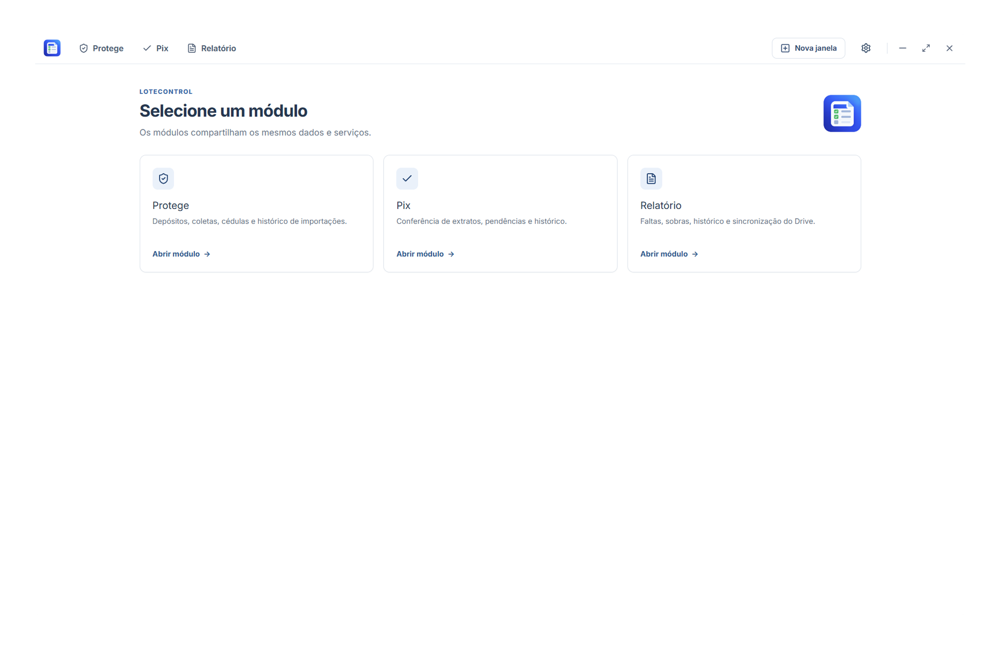

<div align="center">

# LoteControl

### Sistema integrado de gestão financeira, conferência Pix e conciliação de cofres para redes lotéricas.

Centralize rotinas operacionais, automatize a conferência de extratos bancários e controle fechamentos de caixa em uma única aplicação desktop.


<div align="center">
  <a href="https://github.com/guilhermetonin/LoteControl/releases">
    
  </a>
  
  
  
  
  
  
  
</div>




</div>

O **LoteControl** foi desenvolvido para solucionar a fragmentação das rotinas operacionais em casas lotéricas. Em vez de alternar entre diferentes planilhas e utilitários isolados para conferir depósitos de cofres inteligentes, validar transações Pix e consolidar o fechamento de caixa diário, o sistema reúne esses fluxos em uma única interface desktop.

Construído com uma arquitetura *local-first*, o LoteControl mantém os dados operacionais em bancos SQLite locais. O módulo Relatório também conta com sincronização via Google Drive, incluindo versionamento de snapshots e mecanismos para identificar e resolver conflitos entre dispositivos.

---

## Motivação

O LoteControl nasceu de uma necessidade prática: facilitar minhas próprias rotinas de trabalho em uma casa lotérica. A ideia foi reunir ferramentas e processos que antes ficavam separados, tornando tarefas operacionais e conferências financeiras mais organizadas em uma única aplicação.

Embora tenha sido criado inicialmente para uso próprio, o código está publicado para que outras pessoas possam conhecer a implementação, estudar sua estrutura e, respeitando os termos da licença do repositório, adaptá-lo a outras necessidades ou propor melhorias. Como o projeto foi desenvolvido a partir de um contexto específico, adaptações para outros ambientes podem exigir mudanças no código e nos fluxos de trabalho.

---

## Tecnologias e arquitetura

- **Aplicação desktop:** Electron, com interface em React 19 e TypeScript.
- **Interface e build:** Vite, Tailwind CSS e esbuild.
- **Persistência local:** SQLite operado por meio de `sql.js` e WebAssembly (WASM), com substituição atômica de arquivos.
- **Comunicação entre processos:** API tipada via Preload e canais IPC, com políticas estritas de isolamento (`contextIsolation: true`, `nodeIntegration: false`, `sandbox: true`).
- **Sincronização em nuvem:** integração com Google Drive usando OAuth 2.0 com PKCE, proteção de credenciais via DPAPI do Windows (`safeStorage`), versionamento por árvore de snapshots imutáveis (DAG) e comparador de versões para resolução de conflitos.

Saiba mais em detalhes no guia de [Arquitetura do Sistema](docs/arquitetura/arquitetura.md).

---

## Módulos Principais

### Protege

Gerenciamento e conciliação de depósitos e sangrias recolhidos por cofres inteligentes.

- Suporte configurado para as unidades lotéricas da rede (**Caçula**, **Sorte Grande** e **Pupins**).
- Importação de relatórios operacionais com identificação de registros novos e deduplicação automática.
- Armazenamento em banco SQLite local (`protege.db`).
- Suporte à exportação de dados para Excel e JSON.
- Saiba mais no guia do [Módulo Protege](docs/funcionalidades/protege.md).

### Pix

Conferência de transações Pix com extratos bancários da Caixa Econômica Federal.

- Importação de planilhas `.xlsx`, `.xls` e extratos `.csv`.
- Interface com virtualização de linhas e atalhos de teclado para marcação contínua e ágil.
- Painel de pendências com transferência direta de lançamentos para o Relatório diário.
- Totalizadores de seleção em tempo real, incluindo soma, contagem e média.
- Saiba mais no guia do [Módulo Pix](docs/funcionalidades/pix.md).

### Relatório

Consolidação do livro-caixa diário e conciliação financeira das operações de balcão.

- Registro de movimentações por unidade lotérica, data e operador.
- Filtros por dia do mês e operador de caixa.
- Sincronização com Google Drive por OAuth 2.0 com PKCE, com credenciais protegidas via DPAPI do Windows.
- Versionamento de snapshots em DAG, identificação de divergências e tela de comparação (*diff*) para resolver conflitos.
- Fila de sincronização em segundo plano e rastreabilidade com log de alterações.
- Saiba mais no guia do [Módulo Relatório](docs/funcionalidades/relatorio.md).

---

## Download e Instalação

O LoteControl é distribuído por meio de um instalador para Windows.

### Passo a passo

1. Acesse a página de [Releases](https://github.com/guilhermetonin/LoteControl/releases/latest).
2. Baixe o instalador do LoteControl disponível na versão mais recente.
3. Execute o instalador e siga as instruções apresentadas na tela.
4. Ao concluir, abra o LoteControl pelo atalho criado na Área de Trabalho ou pelo Menu Iniciar.

**Requisito de sistema:** Windows 10 ou Windows 11 de 64 bits.

---

## Executar a partir do código-fonte

Para executar o projeto em ambiente de desenvolvimento, instale uma versão compatível do Node.js (22 LTS recomendada) e do npm e execute na raiz do repositório:

```bash
npm ci
npm run dev
```

Para gerar a build de produção da aplicação:

```bash
npm run build
```

Para gerar o instalador do Windows:

```bash
npm run dist
```

Para mais detalhes, consulte os guias de [Ambiente de Desenvolvimento](docs/desenvolvimento/ambiente.md) e [Compilação e Empacotamento](docs/desenvolvimento/build.md).

---

## Documentação Técnica

Para compreender a arquitetura, as funcionalidades e os procedimentos de desenvolvimento, consulte a documentação organizada na pasta [`docs/`](docs/):

- [Visão Geral da Documentação](docs/README.md)
- [Arquitetura do Sistema](docs/arquitetura/arquitetura.md)
- **Funcionalidades:** [Protege](docs/funcionalidades/protege.md) · [Pix](docs/funcionalidades/pix.md) · [Relatório](docs/funcionalidades/relatorio.md)
- **Desenvolvimento:** [Ambiente](docs/desenvolvimento/ambiente.md) · [Build](docs/desenvolvimento/build.md) · [Testes](docs/desenvolvimento/testes.md)
- **Dados:** [Armazenamento](docs/dados/armazenamento.md) · [Migração](docs/dados/migracao.md) · [Backups](docs/dados/backups.md) · [Google Drive](docs/dados/google-drive.md)
