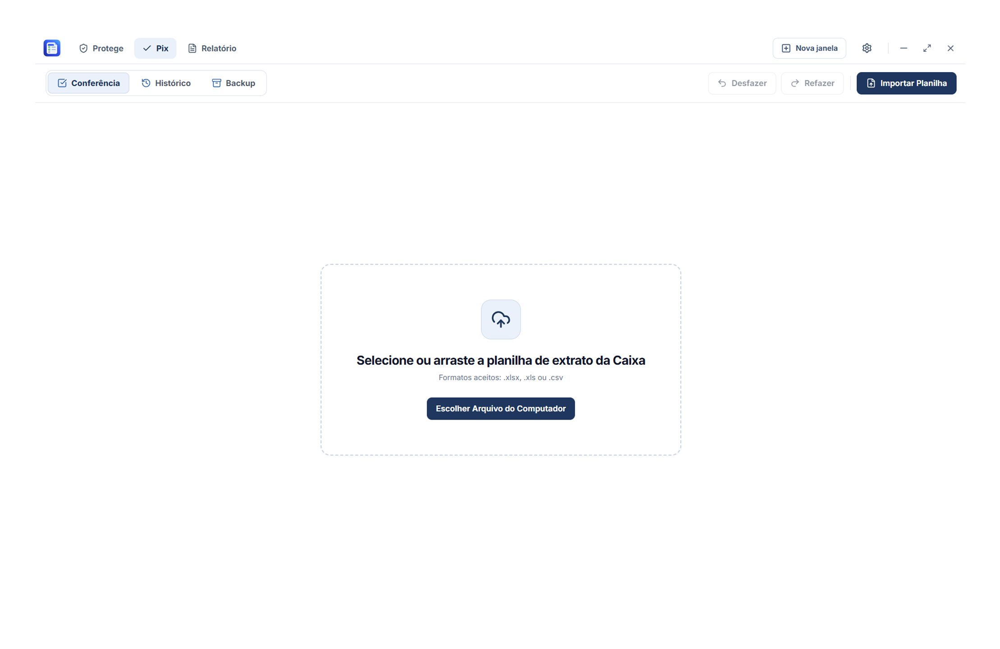

# Módulo Pix

  

## Visão Geral

O módulo **Pix** centraliza a conferência de extratos bancários de operações Pix da Caixa Econômica Federal (CEF), oferecendo um fluxo de trabalho otimizado para conferência rápida de grandes volumes de transações diárias.

## Obtenção e Origem dos Extratos

Para realizar a conferência das movimentações Pix, o operador deve obter o extrato bancário diretamente no canal oficial da instituição:

- **Portal Oficial:** [Portal da Caixa Econômica Federal](https://www.caixa.gov.br/Paginas/home-caixa.aspx)

### Fluxo de Trabalho:
1. Acesse o Internet Banking ou portal corporativo da Caixa.
2. Exporte o extrato bancário da conta nos formatos suportados pelo aplicativo:
   - **`.xlsx`** ou **`.xls`** (Planilha Excel)
   - **`.csv`** (Valores separados por vírgula/ponto e vírgula)
3. No LoteControl, abra o módulo **Pix** e clique em **Importar Extrato** para carregar o arquivo.
4. O sistema processa e normaliza as transações, organizando os lançamentos para conferência.

## Recursos Implementados

1. **Importação e Normalização:**
   - Leitura de arquivos `.xlsx`, `.xls` e `.csv`.
   - Identificação automática de datas, históricos bancários, documentos e valores a crédito/débito.
2. **Conferência Ágil:**
   - Interface de alta performance com virtualização de listas para renderização de milhares de linhas sem travamentos.
   - Navegação e marcação rápida por atalhos de teclado (`Espaço`, `Ctrl`, `Shift`).
   - Resumo em tempo real com valor total selecionado, média e contagem de itens.
3. **Painel de Pendências:**
   - Visualização isolada de transações pendentes de conferência ou justificativa.
   - Função de transferência direta de lotes pendentes para o módulo de Relatório financeiro.
4. **Histórico de Sessões:**
   - Armazenamento das conferências realizadas no banco SQLite local `conferencia_pix.db`.
