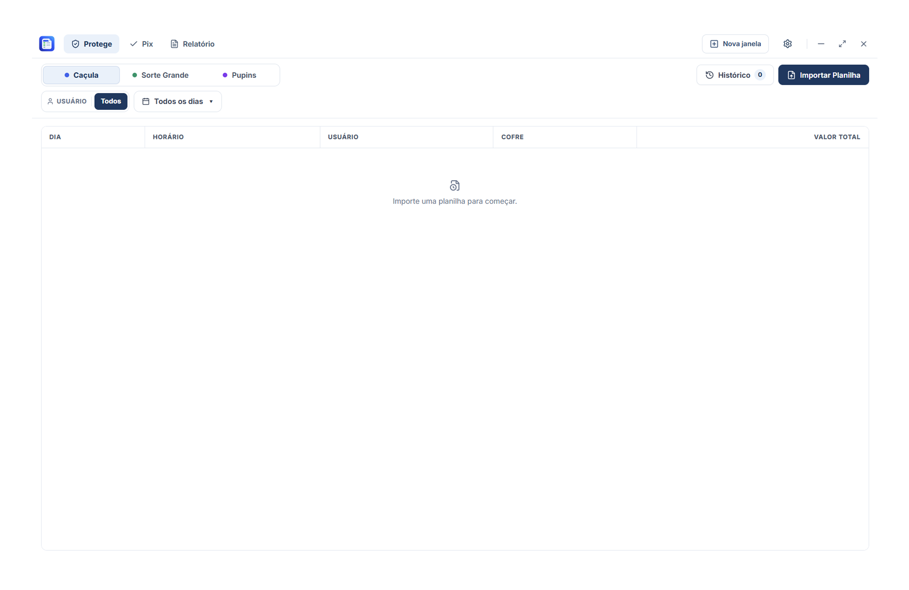

# Módulo Protege

  

## Visão Geral

O módulo **Protege** é responsável pela conciliação de depósitos e movimentações de numerário recolhidos por cofres inteligentes nas unidades lotéricas da rede.

## Obtenção e Origem dos Relatórios

Para conciliar as sangrias e recolhimentos de numerário dos cofres, o operador deve obter o relatório de coletas no portal oficial da transportadora de valores:

- **Portal Oficial:** [Portal Protege](https://portal.protege.com.br/login)

### Fluxo de Trabalho:
1. Acesse o portal da Protege com as credenciais operacionais da unidade.
2. Gere e baixe o relatório de movimentações do cofre inteligente nos formatos aceitos pelo aplicativo:
   - **`.xlsx`** ou **`.xls`** (Planilhas Excel de fechamento/recolhimento)
   - **`.csv`** (Exportação em texto delimitado)
   - **`.json`** (Cópias de segurança estruturadas de sessões Protege)
3. No LoteControl, abra o módulo **Protege** e selecione **Importar Arquivo**.
4. O sistema processa o arquivo, computa os depósitos por lotérica e destaca novos registros versus lançamentos já conciliados.

## Recursos Implementados

1. **Gestão por Unidade Lotérica:**
   - Suporte pré-configurado às lotéricas da rede (**Caçula**, **Sorte Grande** e **Pupins**).
2. **Importação e Deduplicação:**
   - Detecção inteligente de registros duplicados e novos lançamentos por identificador único.
   - Suporte a arquivos `.xlsx`, `.xls`, `.csv` e cópias `.json`.
3. **Persistência SQLite Isolada:**
   - Armazenamento atômico no banco local `protege.db`.
4. **Histórico de Importações:**
   - Aba dedicada para consulta de sessões anteriores, com quantidade de registros importados e data/hora do processamento.
5. **Exportação:**
   - Exportação dos dados consolidados para formatos estruturados (JSON e Excel).
