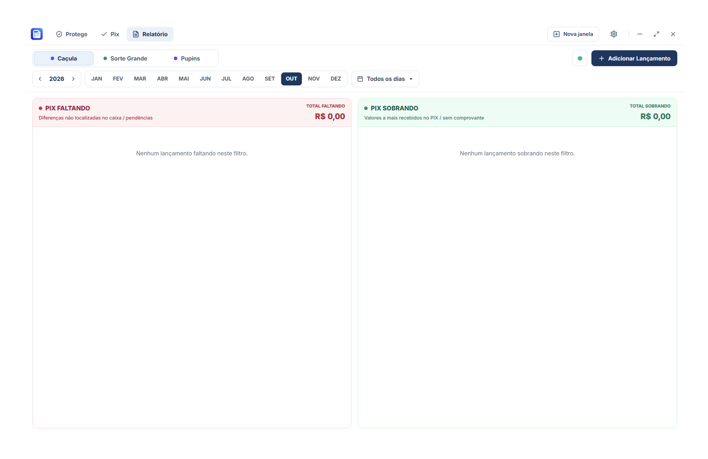

# Módulo Relatório

  

## Visão Geral

O módulo **Relatório** consolida as movimentações financeiras diárias, atuando como o livro-caixa digital da rede lotérica.

## Recursos Implementados

1. **Livro-Caixa Consolidado:**
   - Registro de entradas, saídas e movimentações por lotérica e por operador de caixa.
   - Segmentação e filtros ágeis por dia do mês, unidade lotérica e status.
2. **Integração com Google Drive:**
   - Sincronização periódica ou sob demanda do arquivo de banco de dados do Relatório.
   - Proteção de credenciais OAuth via DPAPI do Windows (`safeStorage`).
   - Resolução de conflitos de versões e fila de sincronização em segundo plano.
3. **Recebimento de Transferências:**
   - Recepção atômica de transações pendentes encaminhadas a partir do módulo Pix.
4. **Persistência e Auditoria:**
   - Banco SQLite local `pix_lotericas.db`.
   - Log interno de auditoria de alterações para rastreabilidade de fechamentos de caixa.
